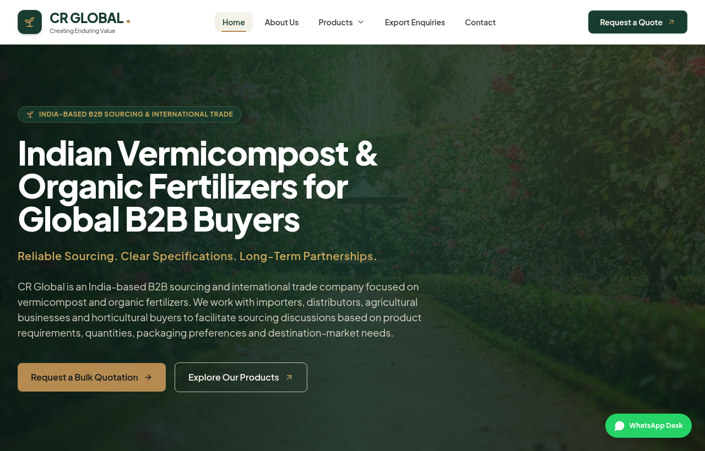
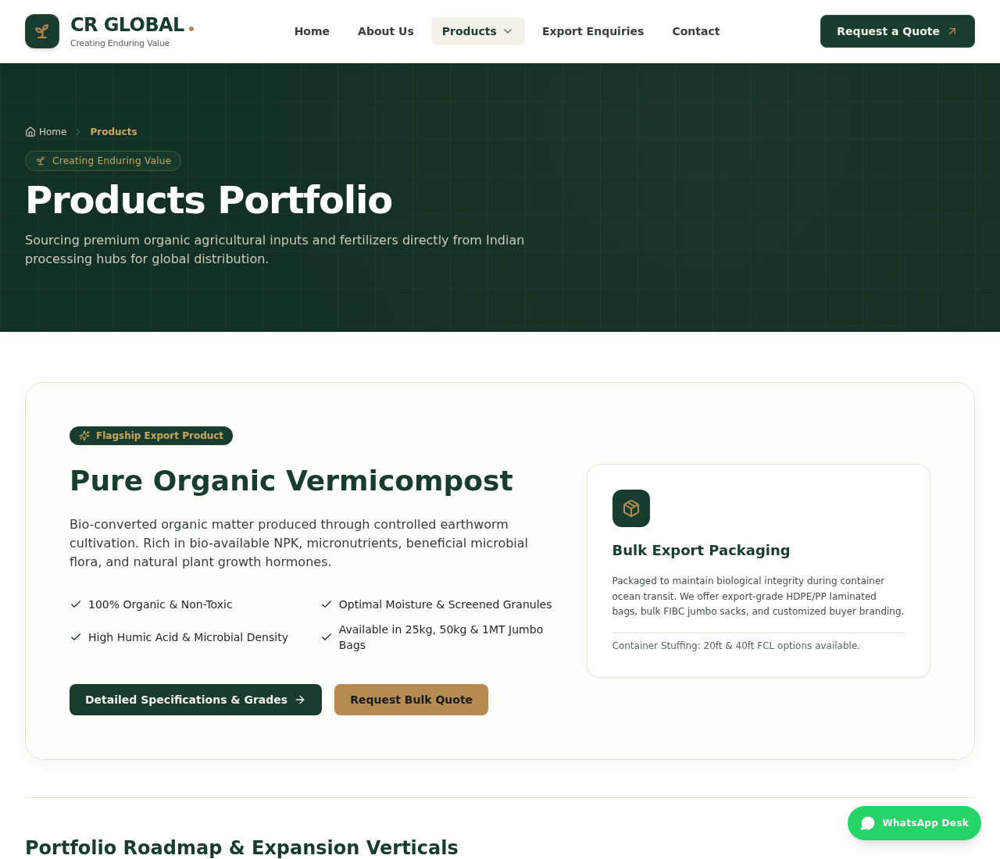
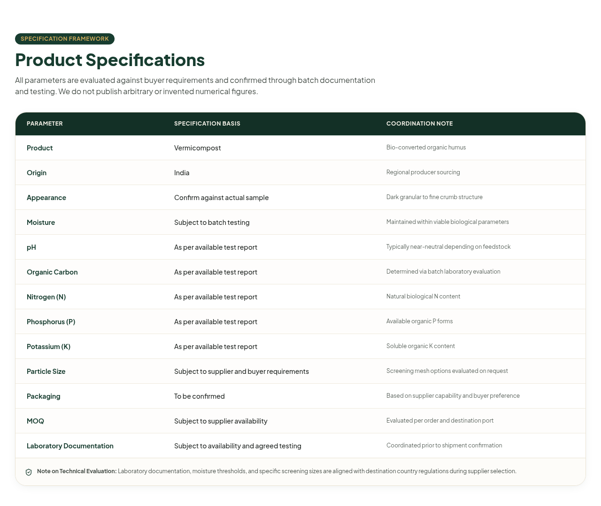
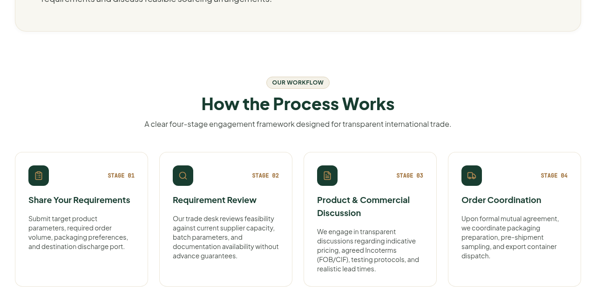
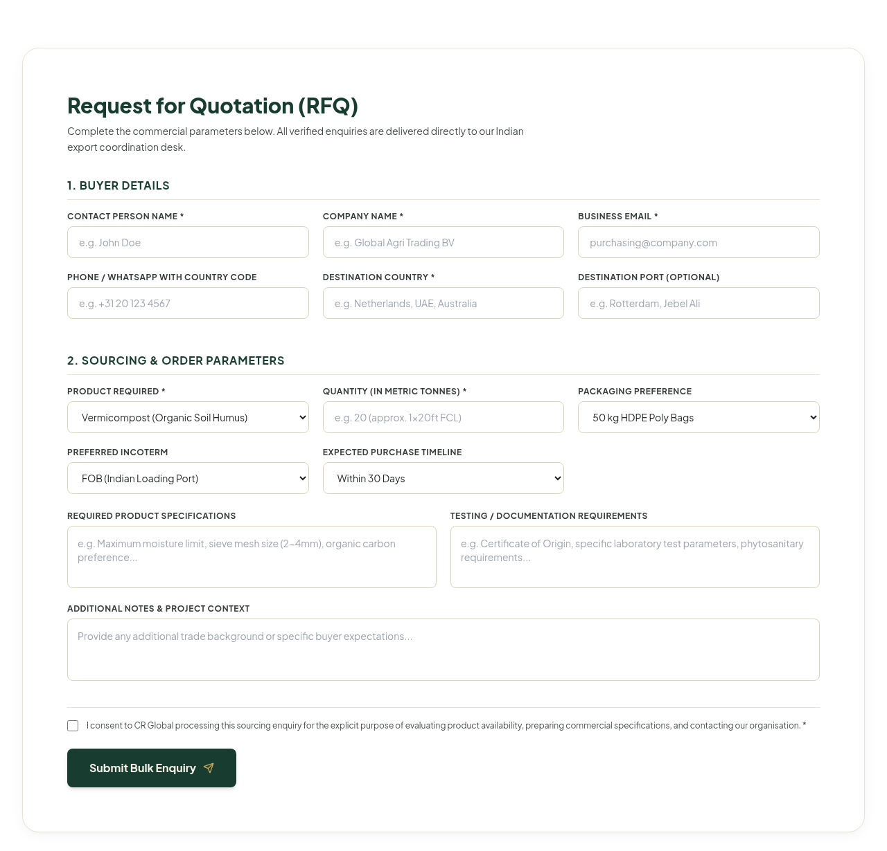

# CR Global — Official Web Platform (V2)


> **CR Global**: India-Based B2B Sourcing & International Trade  
> **Tagline**: Creating Enduring Value  
> **Official Domain**: [https://crglobalindia.com/](https://crglobalindia.com/)  
> **Release Branch**: `V2` (Production-Ready Architecture)  
> **Primary Business**: Facilitating international trade discussions and bulk sourcing of high-grade Indian vermicompost and organic fertilizers for global commercial agricultural and horticultural buyers.

---

## 🚀 What's New in Version 2.0 (V2)

| Feature / Area | Version 1.0 (Initial Prototype) | Version 2.0 (Current Production Release) |
| :--- | :--- | :--- |
| **Business Positioning** | Broad multi-commodity export merchant portal (spices, rice, oilseeds) | Focused, verified B2B sourcing platform for Indian Vermicompost & organic inputs |
| **Routing & Architecture** | Single-page scroll layout | Multi-page SPA with **React Router 7** across 6 canonical routes |
| **Brand Identity & Theme** | Generic maritime blue/navy theme | Refined organic trade palette: Deep Forest Green (`#183D30`), Warm Ivory (`#F4F1E8`), and Earth Gold (`#B58B52`) |
| **Inquiry Backend** | Static frontend form without mail delivery | Production PHP mailer (`public/api/send-enquiry.php`) with rate limiting, honeypot spam protection, and sanitization |
| **SEO & Social Sharing** | Basic meta tags | Dynamic `<SEO>` head manager, 1200x630 Open Graph preview (`og-image.jpg`), canonical XML sitemap, and JSON-LD structured data |
| **Hosting & Web Server** | Generic static hosting guide | Optimized for **Hostinger Apache + PHP** with automated SPA `.htaccess` rewrite rules and caching directives |

---

## 🌟 Architecture & Implemented Routes

This modern React single-page application (SPA) is built with **React 18**, **Vite 5**, **Tailwind CSS 3**, and **React Router 7**. It is optimized for zero-overhead static deployment on **Hostinger shared hosting (Apache + PHP)**.

### Implemented Pages (6 Canonical Routes)
1. **`/` (Homepage)**: Executive introduction, hero section with background imagery, flagship vermicompost overview, 4 core value pillars, 6 target B2B buyer sectors, and primary export quotation CTAs.
2. **`/about` (About Us)**: Company narrative, Vision, Mission, 5 Core Values (Integrity, Quality Focus, Dependability, Transparency, Long-Term Value), 5-stage Business Approach, and forward outlook.
3. **`/products` (Product Portfolio)**: Overview of export-ready organic agricultural inputs, featured vermicompost card, sourcing facilitation details, and future portfolio expansion preview.
4. **`/products/vermicompost` (Vermicompost Product Detail)**: Comprehensive B2B specifications, biological decomposition description, applications (agriculture, horticulture, soil conditioning, nurseries), realistic laboratory specification table, bulk packaging options (50kg HDPE, 1000kg Jumbo bags), trade documentation overview, buyer specification checklist, interactive FAQ accordion, and Schema.org `Product` JSON-LD structured data.
5. **`/export-enquiries` (Export Enquiries & RFQ)**: Transparent 4-stage sourcing process (Share Requirements, Requirement Review, Commercial Discussion, Order Coordination) and a comprehensive B2B RFQ form with validation, honeypot spam protection, rate limiting, and PHP mailer dispatch.
6. **`/contact` (Contact Us)**: Transparent B2B communication hub, verified contact options, validated contact enquiry form with rate-limiting and honeypot protection, verified company email (`export@crglobalindia.com`), and clear corporate disclosure.

> [!NOTE]
> **Strict Route Compliance**: As required by brand specifications, there is **NO** `/quality-sourcing` page anywhere on this website. Quality and sourcing methodologies are directly integrated into our product specifications, export enquiry workflows, and corporate values.

---

## 📸 Platform Functionality & Visual Walkthrough

### 1. Homepage & Executive B2B Positioning

- **Brand Identity**: Features CR Global's corporate emblem, brand tagline *"Creating Enduring Value"*, and verified international trade desk contact options.
- **Value Proposition**: Clearly communicates primary business focus — facilitating bulk sourcing and trade discussions for high-grade Indian vermicompost.
- **Action CTAs**: Immediate access to "Request a Bulk Quotation" and "Explore Our Products", alongside a non-intrusive floating WhatsApp desk.

---

### 2. Product Portfolio & Packaging Solutions

- **Flagship Presentation**: Highlights **Pure Organic Vermicompost** as the primary export line with verified product attributes (screened granules, bio-available NPK, high humic acid content).
- **Packaging Diversity**: Outlines multi-wall HDPE/PP laminated bags (25kg & 50kg) and 1,000kg FIBC jumbo sacks tailored for ocean container transit (20ft & 40ft FCL).
- **Roadmap Preview**: Outlines future organic agricultural input expansions without premature commercial commitments.

---

### 3. Laboratory Specifications & Reference Parameters

- **Verifiable Technical Parameters**: Displays realistic reference benchmarks for Total Organic Carbon, Nitrogen, Phosphorus, Potassium, Moisture, and pH.
- **Commercial Grounding**: Clarifies that specific test reports and batch analyses are conducted per supplier allocation and destination regulatory standards.
- **Zero Inventions**: Strictly avoids fictitious certifications, adhering to standard trade inspection protocols.

---

### 4. 4-Stage International Trade Sourcing Process

- **Stage 01 — Share Your Requirements**: Importers submit target specifications, volume, and destination discharge ports.
- **Stage 02 — Requirement Review**: Trade desk evaluates supplier capacity and documentation feasibility.
- **Stage 03 — Product & Commercial Discussion**: Transparent negotiations on Incoterms (FOB/CIF), testing protocols, and realistic lead times.
- **Stage 04 — Order Coordination**: Formal packaging preparation, pre-shipment sampling, and export container dispatch.

---

### 5. Interactive B2B Request for Quotation (RFQ) Form

- **Comprehensive Commercial Intake**: Captures buyer company details, destination ports, Incoterms (FOB/CIF/CFR), container quantities, and testing requirements.
- **Multi-Layered Security**: Built-in hidden honeypot spam traps, timestamp-based rate limiting, and input sanitization to eliminate automated abuse.
- **Server-Side PHP Mailer**: Dispatches verified enquiries directly to `export@crglobalindia.com` via Hostinger's mail environment, with client-side fallback.

---

## 🏗 Tech Stack & Design System

- **Framework**: React 18.3 + Vite 5.4
- **Routing**: React Router 7 (`BrowserRouter` with `.htaccess` Apache rewrite fallback)
- **Styling**: Tailwind CSS 3.4
  - Primary Forest Green: `#183D30` (`forest-800` / `forest-950`)
  - Warm Ivory: `#F4F1E8` (`ivory-100` / `ivory-50`)
  - Earth Gold: `#B58B52` (`gold-500` / `gold-400`)
  - Dark Charcoal: `#1F2421` (`charcoal-800`)
- **Icons**: Lucide React
- **Forms & Backend**: `public/api/send-enquiry.php` (PHP mailer script tailored for Hostinger shared hosting mail servers) with client-side mailto fallback for offline/local development.
- **SEO & Structured Data**: Dynamic `<SEO>` component for page-specific titles, meta descriptions, canonical URLs, and Open Graph tags; Schema.org `Organization` markup on `index.html` and `Product` markup on `/products/vermicompost`.

---

## 📂 Project Directory Structure

```
CR Global/
├── dist/                          # Production-ready build artifacts for Hostinger
│   ├── index.html                 # Main SPA entry point
│   ├── .htaccess                  # Apache mod_rewrite SPA routing & caching rules
│   ├── sitemap.xml                # Canonical XML sitemap for search engines
│   ├── robots.txt                 # Search engine directives pointing to sitemap
│   ├── favicon.svg                # Branded vector favicon
│   ├── images/
│   │   ├── og-image.jpg           # 1200x630 Branded Open Graph sharing preview
│   │   ├── hero-vermicompost.jpg  # Hero banner imagery
│   │   ├── vermicompost-detail.jpg # Product detail showcase image
│   │   └── about-agriculture.jpg  # About page narrative image
│   ├── api/
│   │   └── send-enquiry.php       # Server-side enquiry mailer for Hostinger
│   └── assets/                    # Optimized JS and CSS bundles
├── docs/                          # Documentation assets
│   └── screenshots/               # High-resolution platform UI walkthrough captures
├── public/                        # Static assets copied directly to dist/ on build
│   ├── .htaccess
│   ├── sitemap.xml
│   ├── robots.txt
│   ├── favicon.svg
│   ├── images/
│   └── api/
├── src/
│   ├── App.jsx                    # Route provider (6 canonical routes)
│   ├── main.jsx                   # React mounting script
│   ├── index.css                  # Tailwind styles and custom utilities
│   ├── components/
│   │   ├── common/
│   │   │   ├── Button.jsx         # Accessible primary & secondary buttons
│   │   │   ├── PageHeader.jsx     # Consistent page banner component
│   │   │   ├── ScrollToTop.jsx    # Viewport reset on route navigation
│   │   │   └── SEO.jsx            # Dynamic document title, canonical & OG manager
│   │   └── layout/
│   │       ├── Navbar.jsx         # Responsive top navigation with mobile drawer
│   │       ├── Footer.jsx         # Accessible footer with verified links & disclaimer
│   │       ├── FloatingWhatsApp.jsx # Verified WhatsApp widget (conditionally shown)
│   │       └── Layout.jsx         # Shell wrapper
│   ├── data/
│   │   └── siteConfig.js          # Centralized configuration with verified details
│   └── pages/
│       ├── HomePage.jsx
│       ├── AboutPage.jsx
│       ├── ProductsPage.jsx
│       ├── VermicompostPage.jsx
│       ├── ExportEnquiriesPage.jsx
│       └── ContactPage.jsx
├── .env.example                   # Environment configuration template
├── package.json                   # Project scripts and dependencies
├── tailwind.config.js             # Tailwind theme & color extension
└── vite.config.js                 # Vite build setup
```

---

## ⚡ Local Development

### 1. Prerequisites
- **Node.js**: v18.0.0 or higher
- **npm**: v9.0.0 or higher

### 2. Installation
```bash
npm install
```

### 3. Run Dev Server
```bash
npm run dev
```
Open `http://localhost:3000` in your web browser.

### 4. Build for Production
```bash
npm run build
```
The compiled, production-ready static bundle will be generated into the `dist/` directory.

---

## 🌐 Hostinger Shared Hosting Deployment Guide

### Deployment Overview
- **Hosting Environment**: Hostinger Shared / Cloud Hosting (Linux Apache with PHP 8.0+)
- **Target Document Root**: `public_html/`
- **Deployment Archive**: `crglobal-hostinger-deploy.zip`

### Step-by-Step Upload Instructions via Hostinger File Manager

1. **Generate the Latest Production Build & Package**:
   ```bash
   npm run build
   cd dist && zip -r ../crglobal-hostinger-deploy.zip . && cd ..
   ```
   *(A pre-packaged `crglobal-hostinger-deploy.zip` is already included in the root directory of this repository).*

2. **Log in to Hostinger hPanel**:
   - Navigate to [https://hpanel.hostinger.com/](https://hpanel.hostinger.com/).
   - Select your hosting account for `crglobalindia.com` and click **Manage**.

3. **Open File Manager**:
   - Under the **Files** section, click on **File Manager** (access files for `crglobalindia.com`).
   - Navigate into the **`public_html/`** folder.

4. **Prepare Document Root (Backup & Clean)**:
   - If there are existing default placeholder files (e.g., `default.php`), delete them.
   - If you are replacing a previous version of the site, select all previous files, click **Zip** or **Download** to create a backup archive (e.g., `backup-previous.zip`), then remove the old files.

5. **Upload & Extract the Deployment ZIP**:
   - Click the **Upload** icon (top right in File Manager) and choose **File**.
   - Select `crglobal-hostinger-deploy.zip` from your computer.
   - Once uploaded, right-click `crglobal-hostinger-deploy.zip` and select **Extract**.
   - Set the destination path to `public_html` (or `.`) so that files are placed directly in `public_html/`.
   - Delete `crglobal-hostinger-deploy.zip` after extraction.

6. **Verify Document Root Structure**:
   Ensure `public_html/` contains the following items directly:
   - `index.html`
   - `.htaccess`
   - `sitemap.xml`
   - `robots.txt`
   - `favicon.svg`
   - `api/` (containing `send-enquiry.php`)
   - `images/` (containing `og-image.jpg`, `hero-vermicompost.jpg`, etc.)
   - `assets/` (containing the bundled CSS and JS files)

7. **Verify Server Configuration**:
   - **PHP Version**: In hPanel, go to **Advanced** -> **PHP Configuration** and ensure PHP 8.1 or 8.2 is active.
   - **SSL Certificate**: In hPanel, go to **Security** -> **SSL** and ensure Lifetime Free SSL is active for `crglobalindia.com` and `www.crglobalindia.com`. The included `.htaccess` automatically forces HTTPS.
   - **SPA Routing**: Direct URL visits to `/about`, `/products`, `/products/vermicompost`, `/export-enquiries`, and `/contact` are automatically rewritten to `/index.html` by Apache `mod_rewrite`.

8. **Rollback Procedure**:
   - If you ever need to roll back to a previous release, simply delete the contents of `public_html/` and extract your `backup-previous.zip` file.

---

## 📋 Verified Business Information & Pending Client Items

To ensure high corporate credibility for international trade buyers, this codebase deliberately avoids fictitious registration numbers, artificial export volumes, and placeholder phone numbers.

### Currently Implemented Verified Details:
- **Company Name**: CR Global
- **Tagline**: Creating Enduring Value
- **Canonical Website**: `https://crglobalindia.com/`
- **Primary Export Desk Email**: `export@crglobalindia.com`
- **General Inquiries Email**: `info@crglobalindia.com`
- **Country of Origin & Operations**: India
- **Core Product Focus**: Indian Vermicompost & Organic Fertilizers

### Items Awaiting Client Verification:
Once officially registered and provided by the business owners, update `src/data/siteConfig.js` and re-run `npm run build`:
1. **Registered Office Street Address**: City, State, and Postal Code in India.
2. **Official Business Phone / WhatsApp Number**: With country code (e.g., `+91 ...`). Once provided, the floating WhatsApp desk will automatically display.
3. **Statutory Registrations** (when issued):
   - Import Export Code (IEC)
   - Goods and Services Tax Identification Number (GSTIN)
   - Corporate Identity Number (CIN) or Udyam Registration
   - APEDA / Certification bodies (if applicable)

---

## 🔒 Security & Performance Features

- **Honeypot Spam Defense**: Forms include hidden honeypot fields that trap automated spam bots without interrupting legitimate users.
- **Client & Server Rate Limiting**: Both frontend time-stamps and backend session checks prevent rapid-fire automated submissions.
- **Content Security & Hygiene**: Clean sanitization of form inputs to prevent header injection or XSS.
- **Static Asset Optimization**: Gzip compression and long-term HTTP browser caching headers configured via `.htaccess`.
- **Zero Fictional Endorsements**: All claims adhere strictly to realistic vermicompost properties and genuine trade processes.
